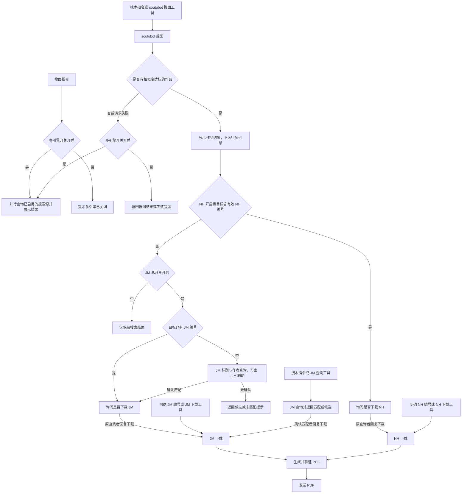

# 综合搜图功能

AstrBot 的搜图、作品查询和 PDF 下载插件。支持 soutubot 搜图、JM 查询与下载、NH 下载，以及 SauceNAO / Yandex / ascii2d / Google Lens 多引擎检索。

**当前版本：4.6.1** · Python 3.11+ · 支持平台：aiocqhttp

## 安装与首次使用

1. 在 AstrBot 插件管理中上传插件 ZIP，或通过仓库地址安装：`https://github.com/suisuizi168/astrbot_plugin_soutubot`。
2. 等待 AstrBot 根据 `requirements.txt` 安装依赖，确认插件加载成功。
3. 打开插件配置，按需设置会话白名单、JM/NH 开关和 PDF 密码。默认 JM、NH 均开启，白名单留空表示全部会话可用。
4. 发送图片并附带 `/找本`，或单独发送 `JM编号` / `NH编号` 进行测试。

找本、搜本匹配到可下载作品后均先询问，原查询者在当前会话回复“下载”才进入下载和 PDF 发送。确认有效期由“通用设置 → 下载确认有效期（秒）”设置，默认 600 秒；下载询问提示同步显示实际值。不回复不下载，超时需重新查询；同一用户同一会话以最近一次下载询问为准。明确 JM/NH 编号和明确下载工具仍直接下载。

新安装默认开启 NH；升级时，已保存的关闭设置会保留。SauceNAO 需要填写自己的 API Key，未填写会跳过该来源。

## 指令与调用方式

“通用设置 → 触发昵称”默认留空，留空不启用昵称指令。填写如 `小岁` 后，可附图或引用图片发送 `小岁找鸡`、`小岁找本`、`小岁搜图`，昵称与指令之间允许空格，无需 @ 或 `/`。只完整匹配当前消息，不读取引用内容中的指令；原有指令继续可用，共用原有白名单、开关和冷却。同一条消息同时符合全局唤醒词与昵称入口时仅执行一次。

找鸡无可展示结果时回复“未找到鸡，可能目前暂未收录”；发生错误且无结果可保留时回复“找鸡出现错误，请稍后重试”。部分渠道或 LLM 失败仍保留可用来源。聊天回复不显示 Google Lens、谷歌识图或 SerpAPI 渠道诊断，真实来源平台与出处链接保留；后台配置和日志保留诊断信息。

| 需求 | 用法 | 行为 |
| --- | --- | --- |
| 按图片找本 | 图片与 `/找本` 同条发送；也可引用图片发送指令 | 先查 soutubot，未达标或请求失败时多引擎兜底；达标作品按开关选择下载来源，回复确认后下载 |
| 通用图片搜图 | 图片与 `/搜图` 同条发送；也可引用图片发送指令 | 直接并行查询已开启的 SauceNAO / Yandex / ascii2d / Google Lens，仅返回搜索结果 |
| 找鸡查作者 | `/找鸡` 附图或引用图片；也支持 `/找鸡 图片链接` | 先回复“收到，开始找鸡”，并行查询 SauceNAO 和 Google Lens，识别后仅展示一条作者、账号与出处 |
| 按名称查询 JM | `/搜本 作品名称`；也可引用标题发送 `/搜本` | 确认匹配后，原查询者可在同一会话的配置有效期内回复“下载”（默认 600 秒）；候选不明确时展示候选 |
| 按编号下载 JM | `JM123456`、`jm 123456`、`/Jm123456` | 直接下载 → 生成 PDF → 发送 |
| 按编号下载 NH | `NH123456`、`nh 123456`、`/nH123456` | 直接下载 → 生成 PDF → 发送 |
| 按 NH 链接下载 | `/nh https://nhentai.net/g/123456/` | 下载对应作品并发送 PDF |
| 查看帮助 | `/搜图帮助`（兼容 `/jm帮助`、`/JM帮助`） | 按实际触发昵称生成简明功能说明 |
| 清理 JM 缓存 | `/jm清理` | 仅缓存管理员可用，跳过下载或发送中的作品 |

编号仅为格式示例。JM/NH 的大小写可以任意组合，编号前的空格和 `/` 前缀均可省略；完整的“来源＋编号”消息不需要 @ 机器人，也不依赖 LLM。兼容原来的 `/jm JM123456` 写法。

明确编号入口只匹配整条消息，不从一句话中截取编号。它会遵守白名单、来源开关和队列限制，并阻止继续进入普通 LLM 对话；带空格的格式也只会执行一次下载。

自然语言请求，例如“帮我把 JM123456 转成 PDF”，由 LLM 工具理解。只有编号而没有来源时，不会由明确编号入口自动下载。

## 搜图后的处理流程



- `/搜图` 直接使用多引擎，不访问 soutubot、不查询 JM、不下载作品；多引擎关闭时明确提示。两个图片指令共用白名单、用户冷却和待处理任务上限。
- `/找本` 的 soutubot 默认达标相似度为 **80%**。达标后不运行、不展示多引擎结果，即使下载关闭或失败也不会改用多引擎。
- 下载确认以最高分命中的作品为目标，保留该命中的全部来源；不会为了使用 NH 而改下载另一条较低分作品。
- NH 开启且目标有有效 NH 编号时优先 NH；否则 JM 开启时使用已有 JM 编号，或继续查询 JM。EH 来源也按这一规则转 JM 查询。
- NH 下载失败不会自动切换到 JM；JM 候选不明确时不会自动选择第一项下载。
- 进入下载后始终生成 PDF 并发送，没有单次“是否生成 PDF”的分支。失败时会提示失败阶段。

## 常用配置

配置按 **LLM → 搜图与通用 → 多引擎 → 找鸡 → Google Lens → JM → NH → PDF** 排列，PDF 参数集中在末尾，分别标明 JM/NH 归属。

| 配置项 | 默认 | 作用 |
| --- | --- | --- |
| `llm_tools_enabled` | 开启 | LLM 总开关，同时控制工具入口和 JM 模型辅助 |
| `jm_llm_enabled` | 开启 | JM 查询词提取与候选核验，受 LLM 总开关控制 |
| `whitelist` | `[]` | 留空全部会话可用；群聊填写群号，私聊填写用户 ID |
| `multi_search_enabled` | 开启 | 控制 `/搜图` 直接查询和 `/找本` 未达标或请求失败后的多引擎兜底 |
| `saucenao_enabled` / `yandex_enabled` / `ascii2d_enabled` | 开 / 开 / 关 | 各搜索源独立开关；SauceNAO 另需 API Key |
| `jm_enabled` | 开启 | 统一控制 JM 查询和下载 |
| `nh_download_enabled` | 开启 | NH 下载与搜图后的 NH 自动分流 |
| `min_similarity` | 80% | soutubot 达标阈值 |

关闭 LLM 总开关或 JM 辅助开关后，JM 使用原始标题查询，不做模型关键词提取与候选核验。辅助开关提示为“不开启的话精度极低”；明确编号下载不受 LLM 开关影响。

四个工具入口为 `soutubot_search_tool`、`jm_search_tool`、`jm_download_tool`、`nhentai_download_tool`。自然语言工具选择由模型决定，固定格式的明确编号由代码直接识别。

`soutubot_search_tool` 对应 `/找本` 流程；通用多引擎查询使用 `/搜图` 指令。

完整的 71 项配置、默认值与固定限制见 [配置手册](docs/CONFIGURATION.md)。

## 找鸡：并行作者与来源查询

找鸡并行查询 SauceNAO 和已启用的 Google Lens，不调用 soutubot，不触发作品下载。复用会话白名单；找鸡的 SauceNAO 客户端、代理、冷却、任务队列及相似度设置独立，Google 使用集中配置和跨入口缓存。固定最多同时执行 2 个找鸡任务，队列上限使用 `max_pending_tasks` 的数值但单独计数。找鸡默认通过独立的 LLM 判断配置识别原作者，不受通用 LLM 工具开关影响。

在配置面板的连续“找鸡”组填写 `findchicken_api_key`，按需要填写 `findchicken_proxy`。不会自动读取多引擎的 SauceNAO Key；代理留空表示直连。每个来源默认最多取 30 条候选，最终固定展示 1 条；SauceNAO 最低相似度 30%、搜索超时 30 秒、冷却 10 秒，默认不显示相似度。Google 使用独立的搜索超时。只有一个服务配置了 Key 时仍可使用。

通过权限和冷却检查后，后台先发送“收到，开始找鸡”，再处理图片和查询。支持附图、引用图片、文本图片链接，以及 QQ 回复图片时自动插入被回复者 @ 的消息；普通聊天不会触发。

```text
🎯 已找到鸡
🌐 平台：X (Twitter)
匹配：视觉匹配
👤 名字：example_artist
🆔 账号：@example_artist
https://x.com/example_artist

⚠识图存在误差，请自行核对哦~
```

在“找鸡｜作者识别模型”中通过 AstrBot 原生选择器选择已配置的聊天模型；留空跟随当前会话模型。默认开启 LLM，模型判断超时 60 秒。只传候选证据，不传原图、不使用聊天记录或工具。先参考接口相似度，再区分原作者与转载者；LLM 优先检查 X/Twitter；没有合适 X 时再检查 Pixiv 和其他平台。不能仅凭 X 域名认定原创。Google 排名不当作相似度，不编造百分比。

对于缺少身份的 X/Pixiv/TikTok/B站作品候选，最多并发读取 6 个固定平台公开接口（X/TikTok oEmbed、Pixiv 作品元数据、B站视频元数据）来补全名字和账号，6 秒超时，失败仍保留原搜索线索。发布账号不自动等于原作者，模型仍需排除转载者。其他网站仅使用已有搜索证据，不能保证从所有转载页追溯到原帖。

所有平台共用同一流程：并行搜索 → 收集每个来源多条候选（默认各最多 30 条）→ 补充发布者信息 → LLM 从整批候选优先选择原作者 → 校验该候选的名字、账号、链接 → 最终只返回一条。

LLM 不再按可信度或“原创证明”拦截结果。模型未选中、格式错误、超时、未配置，或关闭 LLM 时，均按已返回候选的真实相似度从高到低保留一条；没有分数时按 Google 搜索排名保留第一条。配置的相似度阈值只适用于 SauceNAO，Google 不提供百分比。兜底显示“找到匹配来源”，明确提示未确认原作者，缺失名字/账号显示“未提供”，不把网页标题当作者。

名字优先使用平台元数据；X 常见“显示名 on X: …”及 Instagram/DeviantArt 的明确署名由代码解析，其他平台也可由 LLM 逐字引用标题中的发布者署名。名字不必等于账号，不要求标题同时包含 @账号。所有提取均绑定同一来源，冲突账号与编造名字仍会被拒绝并转为匹配来源兜底。

识别范围包括 Instagram、TikTok、Threads、Facebook、微博、哔哩哔哩、Reddit、Pinterest、Tumblr、VK、FANBOX、ArtStation、DeviantArt、Flickr、500px、Imgur 及图站。未知站点也保留为候选。模型只接收候选文字、链接与公开发布页摘要，不接收原图。日志仅记录候选数量与结果代码，不记录原始模型内容或密钥。单元测试和构造样例不代表真实图片准确率。

结果不显示引擎，链接和图片输入统一显示“匹配：视觉匹配”。只有接口提供数值且开启相似度展示时才追加百分比。保留 Emoji、作者主页和单独的原发布出处链接。旧 `findchicken_max_results` 展示数不再使用，以 `findchicken_candidate_limit` 控制候选数量；最终始终只有一条。

## Google Lens（SerpAPI）

搜图与找鸡都并行使用 Google Lens；找本仍先查询 soutubot，未达标时才进入包含 Google 的多引擎兜底。搜图和找本保持原有展示；LLM 只参与找鸡的作者识别与来源判断。

在集中排列的“Google Lens”配置组填写 `google_lens_api_key`：[注册](https://serpapi.com/users/sign_up) · [获取 Key](https://serpapi.com/manage-api-key)。`google_lens_search_enabled` 和 `google_lens_findchicken_enabled` 分别控制两条流程。未填 Key、额度不足、超时或服务失败时，其他来源继续返回结果。

搜图中的 Google 结果继续通用展示网站、标题、来源链接和匹配类型。找鸡中的 Google 候选进入独立的原作者识别流程，不直接展示网页标题。仅相同作品 URL 合并证据，不因作者相同而合并不同作品。

默认先查 `all`（Google 网页的“全部”入口），解析同图、视觉及网页结果，有链接但缺少标题的条目也保留。全部/外观匹配为空时由 `google_lens_retry_empty` 控制补查；有结果但没有可解析账号的 X 发布链接时，由 `google_lens_expand_sources` 控制补查。两种情况都最多补查一次，不根据站点类型直接认定作者。最多两次搜索，共用一次图片上传和原 30 秒总超时，补查可能额外消耗一次额度；精确同图模式不自动扩大范围。相似图和同图页面都不能保证是原作者。每模式最多收集 60 条，两个模式按各自顺序交错合并并按作品链接去重，找鸡在候选上限内优先保留 X、其他已整合平台、未知站点，并保留原搜索顺序作为排名证据，再交给 LLM 选择；不会让补查候选全部排在首轮末尾。未知站点也保留。补查失败保留首轮已有结果且不缓存该次不完整结果。默认搜图最多展示 3 条，非空结果缓存 1 小时，空结果最多缓存 30 秒、到期绕过上游旧缓存。两个入口共享 Google 缓存与相同请求的进行中任务，但不共享命令冷却；失败不缓存，缓存最多 128 项。URL 输入按完整 URL 缓存，图片输入按内容哈希缓存，URL 与图片字节不会自动视为同一项。

Google 诊断日志记录查询模式、搜索编号、原始分组数量及保留数量，不记录图片地址、搜索标题或密钥。零候选时区分服务失败和服务返回空结果；空结果不代表 Google 网页端也没有结果。

附件先压缩到不超过 500 KB，再上传 SerpAPI 获取 `image_id` 并立即搜索；文本图片链接直接交给 SerpAPI，无需给 AstrBot 开放公网文件服务。Google 的代理留空直连，独立于其他引擎。查询消耗 SerpAPI 账号额度，套餐以[官方说明](https://serpapi.com/pricing)为准。

## PDF、缓存与发送

- JM/NH 默认启用 PDF 密码，固定密码留空时使用各自的纯数字作品编号；发送提示会显示密码。
- 默认 PDF 发送上限为 **200 MB**。超过上限时保留文件，不尝试发送；平台自身可能有更低限制。
- 两个来源各自维护下载任务和缓存，数字编号相同也不会混用。同来源、同编号的进行中下载会合并，同会话不会重复排队发送。
- PDF 生成成功后默认清理原始图片；PDF 失败时保留完整图片清单，重试可复用。已保留的图片不主动过期。
- PDF 默认缓存 **7 天**，过期后在再次请求时重建；默认发送后保留。JM 可配置发送成功后删除 PDF。
- 缓存位于 `<AstrBot 数据目录>/plugin_data/astrbot_plugin_soutubot/jm` 和同级 `nh` 目录。`/jm清理` 只清理 JM 缓存。

搜图结果与后续阶段提示分开发送。PDF 加密失败不会发送明文替代文件；发送超时、断线等结果不确定时，保留文件且不自动重发。只有平台明确拒绝时，才允许受白名单约束的私聊回退。

## 常见问题

**为什么没有 SauceNAO 结果？** 先检查多引擎总开关、来源开关与 API Key。`/找本` 的 soutubot 结果已经达标时不会查询其他引擎；可使用 `/搜图` 直接进行多引擎查询。

**为什么下载失败或超时？** 搜图、JM、NH 访问的是不同服务，需要分别检查网络。JM 使用 `jm_proxy`；NH 和多引擎使用环境代理设置。插件不修改代理或 Cookie。

**为什么 PDF 已生成却发不出去？** 先核对大小限制和平台返回信息。AstrBot 与 NapCat 分容器部署时，需要配置宿主的 `callback_api_base` 并确保文件服务可达；这不是本插件的配置项。

**为什么更新后仍未开启 NH？** 新默认值不会覆盖已保存的 `false`，需要在插件配置中手动开启。

## 从 3.x 升级

- `/找本` 图片搜索达到阈值后，会按来源开关选择可下载作品；与 `/搜本` 一样，等待原查询者回复“下载”后才进入下载。`/搜图` 仅返回多引擎搜索结果。
- JM 查询与下载合并为 `jm_enabled`。旧的 `jm_download_enabled`、`search_jm_enabled` 不再生效。
- `llm_tools_enabled` 关闭后，JM 模型辅助也关闭。
- JM 子任务、标题检索、作者检索三个超时固定为 20 秒，原对应配置项已移除。LLM 调用超时和下载超时仍可配置。
- PDF 配置字段名保持不变，重新排列不会重置已保存的密码与缓存设置。

## 更多文档

- [完整配置与默认值](docs/CONFIGURATION.md)
- [模块结构与开发验证](docs/DEVELOPMENT.md)
- [更新记录](CHANGELOG.md)
- [第三方来源与许可](THIRD_PARTY_NOTICES.md)

本项目采用 [MIT License](LICENSE)。多引擎客户端改编自 Shawlei 项目，保留原许可；LLM 入口与 NH 下载参考相关项目流程独立实现，详见第三方说明。

## 配置分区

配置使用 AstrBot 原生分区：通用设置、找本、搜图、找鸡、JM、NH、PDF。Google Lens 并入搜图，注明搜图与找鸡共享；PDF 区域集中管理 JM、NH 各自的密码、缓存与发送设置。JM 内细分查询、LLM 辅助和下载。已有字段的默认值、范围、密钥保护和模型下拉选择器保持不变。旧平铺配置自动迁移并备份，已关闭的开关、空值列表、模型和密钥不会被默认值覆盖。隐藏的旧字段仅作为升级兼容占位，正常配置请使用分区中的选项。
